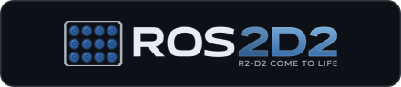
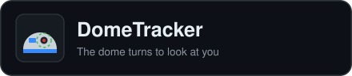
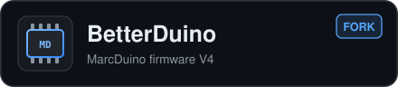

## Hi, I'm Fernando

I build an R2-D2 in Spain, as a member of [Astromech Spain](https://www.astromechspain.com/). Most of what is here is the software that makes my droid work, shared in case it helps other builders. The build itself, from the first part to the last screw, is on Astromech.net: [R2D2 by NandoMadrid](https://astromech.net/forums/showthread.php?47005-R2D2-by-NandoMadrid).

### R2-D2 projects

<table>
  <tr>
    <td width="50%" valign="top">
       
      A ROS 2 brain for an R2-D2 running ShadowMD: a Raspberry Pi adds the senses (cameras, voice, lidar) and the Mega keeps the motors, sounds and lights. The controller always wins.
    </td>
    <td width="50%" valign="top">
       
      A cleaned-up Shadow MD for the Arduino Mega ADK, with PS3 Navs or Joy-Cons, MarcDuino / BetterDuino and AstroPixels Plus. Comes with a web console to calibrate panels and holos, find your parts and flash the Mega from the browser.
    </td>
  </tr>
  <tr>
    <td width="50%" valign="top">
       
      R2-D2's dome turns to look at you: a camera on the dome finds the nearest face and a Raspberry Pi tells the Mega how fast to turn.
    </td>
    <td width="50%" valign="top">
       
      The classic Shadow MD with three MarcDuino boards, plus optional PC forwarding (for the web console) and ROS2D2 support. Off by default: it builds exactly as before.
    </td>
  </tr>
  <tr>
    <td width="50%" valign="top">
       
      BetterDuino firmware for the MarcDuino boards, kept up to date with the original. The dome slave also passes holo commands to AstroPixels.
    </td>
    <td width="50%" valign="top">
       
      Firmware for the AstroPixels boards (logics, PSIs and holo lights), with holo and ReelTwo commands that also work from the Shadow MD controller.
    </td>
  </tr>
  <tr>
    <td width="50%" valign="top">
       
      Padawan360 remote control, with Nintendo Switch Joy-Cons instead of the Xbox controller.
    </td>
    <td width="50%" valign="top">
       
      The Spanish astromech builders' club. Be happy and build droids.
    </td>
  </tr>
</table>

### On Astromech.net

- [R2D2 by NandoMadrid](https://astromech.net/forums/showthread.php?47005-R2D2-by-NandoMadrid): the build thread of my R2-D2
- [ShadowMD Lite](https://astromech.net/forums/showthread.php?47015): the sketch and its web console
- [ROS2D2](https://astromech.net/forums/showthread.php?47099): the ROS 2 brain
